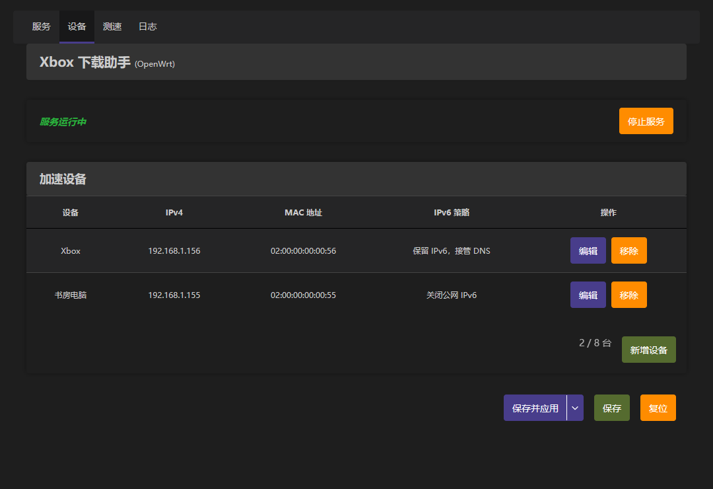
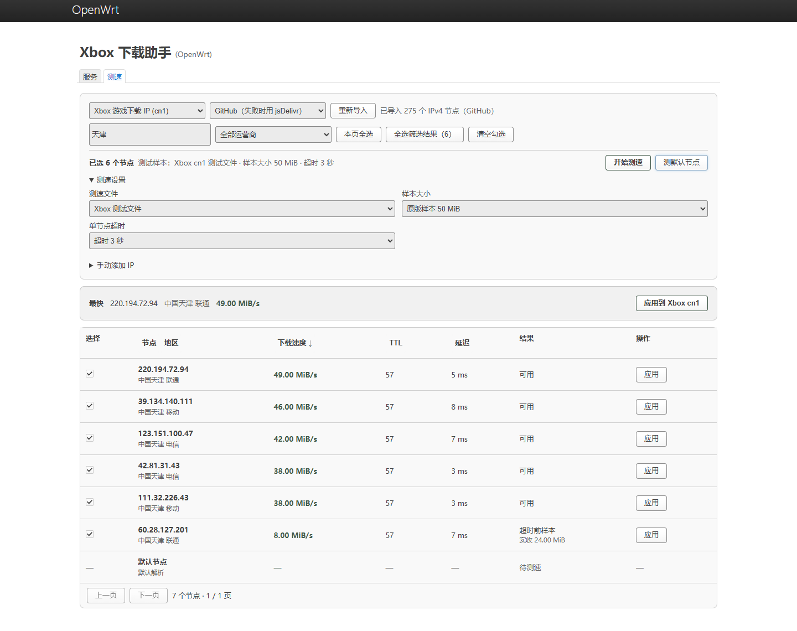
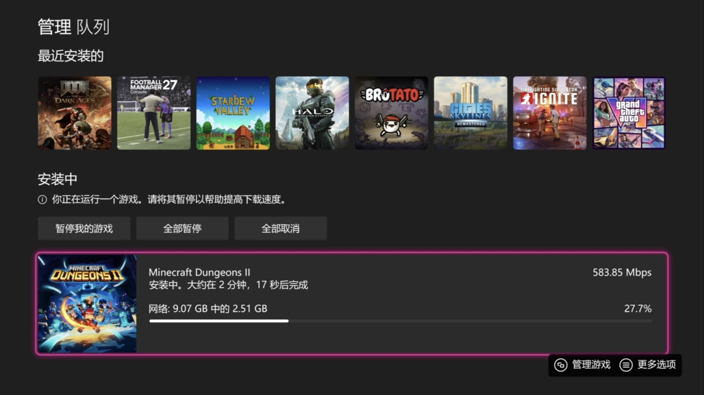

  

<h1 align="center">Xbox 下载助手 for OpenWrt</h1>

  运行在 OpenWrt 路由器上的 Xbox 下载加速插件，通过 LuCI 网页界面管理下载线路、加速设备和 CDN 节点。

  
  
  
  

  <a href="https://github.com/Zachery-Liu/luci-app-xboxdownload-openwrt/releases">下载安装包</a>
  &nbsp;·&nbsp;
  <a href="https://github.com/Zachery-Liu/luci-app-xboxdownload-openwrt/wiki">使用文档（Wiki）</a>
  &nbsp;·&nbsp;
  <a href="https://github.com/Zachery-Liu/luci-app-xboxdownload-openwrt/issues">问题反馈</a>

## 项目介绍

在 OpenWrt 路由器上为指定设备管理 Xbox 游戏和应用下载线路。插件通过 DNS 解析与 HTTP 302 跳转，将相关下载请求引导至选定的 CDN 节点，设备直接连接 CDN 下载。

所有设置均可通过 LuCI 完成，包括设备选择、线路配置、节点测速、IPv6 策略和运行状态查看。

## 功能特性

- **按设备加速**：支持最多 8 台设备，分别管理 IPv4 地址、MAC 地址和 IPv6 策略。
- **下载线路管理**：提供「DNS + HTTP 302」和「仅 DNS 选点」两种模式，支持 Xbox、微软商店以及 PlayStation、Nintendo、EA 等下载线路。
- **CDN 节点测速**：支持在线导入节点和手动添加 IP，查看下载速度、延迟和 TTL，并直接选用测速节点。
- **IPv6 设备策略**：可按设备保留 IPv6、接管 IPv6 DNS 或限制公网 IPv6。
- **状态与日志**：查看服务运行状态、DNS 上游切换情况以及 DNS 查询、HTTP 跳转记录。
- **故障恢复**：包含 DNS 上游回退、服务健康检查和防火墙接管规则清理。

## 界面预览

### 服务管理

查看服务状态、已选设备和当前下载线路。

### 设备管理

按设备配置加速地址与 IPv6 策略。

### CDN 节点测速

导入和测试 CDN 节点，查看测速结果并选择下载线路。

Xbox 下载实测

## 下载与文档

- **[GitHub Releases](https://github.com/Zachery-Liu/luci-app-xboxdownload-openwrt/releases)**：获取 OpenWrt APK 安装包。
- **[项目 Wiki](https://github.com/Zachery-Liu/luci-app-xboxdownload-openwrt/wiki)**：安装说明、配置教程及常见问题。

## 致谢与开源协议

项目参考了 [skydevil88/XboxDownload](https://github.com/skydevil88/XboxDownload) 的下载加速方案、域名规则与测速资源，并针对 OpenWrt 实现 LuCI 管理界面和相关服务逻辑。

本项目采用 [AGPL-3.0-only](LICENSE) 开源协议。

Xbox 是 Microsoft 集团公司的商标。本项目为独立开发的开源软件，与 Microsoft 无隶属、赞助或认可关系。
