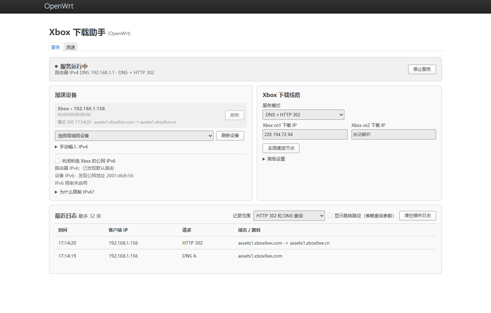

# Xbox 下载助手（OpenWrt）

面向 OpenWrt 25.12 的 LuCI 插件。由路由器为选定设备加速 Xbox 下载，设备直接连接 CDN。

**原版 Xbox 下载助手** [skydevil88/XboxDownload](https://github.com/skydevil88/XboxDownload)

- **按设备加速** · 支持 IPv4 和 IPv6 DNS 分流，可保留 Xbox 的公网 IPv6。通过 HTTP 302 将符合规则的下载请求跳转到国内 CDN，也可仅使用 DNS 选点。
- **CDN 测速选点** · 支持在线导入和手动输入节点，显示下载速度、延迟和 TTL。测速后可直接应用节点。
- **服务状态与日志** · 在 LuCI 查看加速设备、DNS 回退状态和最近的下载跳转记录。

## 界面预览

截图为界面预览，使用示例数据。

### 服务配置

### 节点测速

## 上游与许可证

域名和跳转规则参考[原版 OpenWrt 教程](https://github.com/skydevil88/XboxDownload/blob/master/README_OpenWrt.md)。测速沿用原版样本，微软商店样本由原版网站接口查询。[节点列表](https://github.com/skydevil88/XboxDownload/tree/master/IP)在运行时从 GitHub 或 jsDelivr 获取。

本项目的独立实现采用 [AGPL-3.0-only](LICENSE)。
