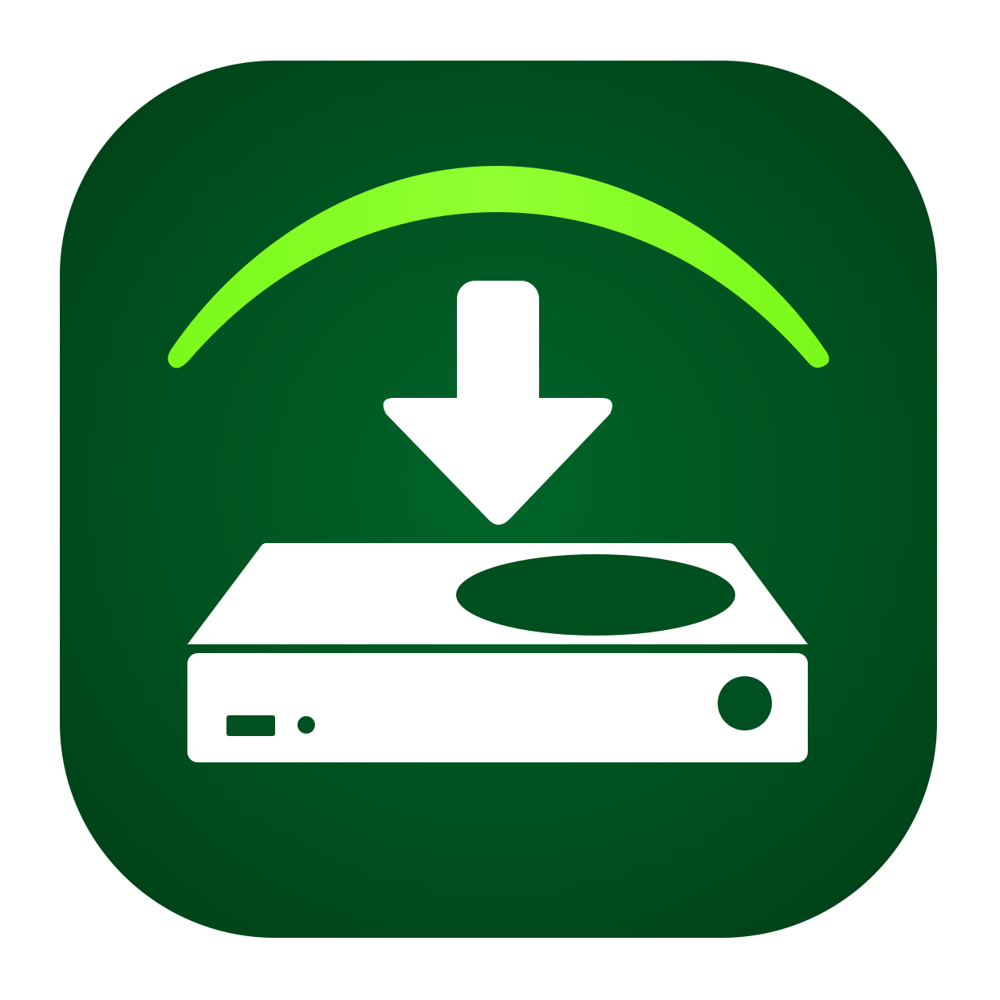

  

<h1 align="center">Xbox 下载助手 for OpenWrt</h1>

  运行在 OpenWrt 路由器上的 Xbox 下载加速插件，通过 LuCI 网页界面管理下载线路、加速设备和 CDN 节点。

  
  
  
  

  <a href="https://github.com/Zachery-Liu/luci-app-xboxdownload-openwrt/releases">下载安装包</a>
  &nbsp;·&nbsp;
  <a href="https://github.com/Zachery-Liu/luci-app-xboxdownload-openwrt/wiki">使用文档（Wiki）</a>
  &nbsp;·&nbsp;
  <a href="https://github.com/Zachery-Liu/luci-app-xboxdownload-openwrt/issues">问题反馈</a>

## 项目介绍

在 OpenWrt 路由器上为指定设备管理 Xbox 游戏和应用下载线路。插件通过 DNS 解析与 HTTP 302 跳转，将相关下载请求引导至选定的 CDN 节点，设备直接连接 CDN 下载。

所有设置均可通过 LuCI 完成，包括设备选择、线路配置、节点测速、IPv6 策略和运行状态查看。

## 功能特性

- **按设备加速** · 支持最多 8 台设备，分别管理 IPv4 地址、MAC 地址、IPv6 策略、DNS 上游和 CDN 线路。
- **下载线路管理** · 提供「DNS + HTTP 302」和「仅 DNS 选点」两种模式，支持 Xbox、微软商店、PlayStation、Nintendo 和 EA 等下载线路。
- **CDN 节点测速** · 支持在线导入和手动添加节点，查看下载速度、ICMP 延迟、TCP 建连时间和 TTL，并从结果中选用节点。
- **状态与日志** · 显示服务运行状态、上游切换情况、IPv4 和 IPv6 DNS 查询及 HTTP 跳转记录。
- **故障恢复** · 支持本地 DNS 健康检查、上游回退和异常退出时的防火墙清理。

## 快速开始

1. 从 [GitHub Releases](https://github.com/Zachery-Liu/luci-app-xboxdownload-openwrt/releases) 下载 APK，将它上传到路由器的 `/tmp/`，再通过 SSH 运行 `apk add --allow-untrusted /tmp/实际文件名.apk`。每个新版 APK 都附有对应的 `.sha256` 校验文件。
2. 在 LuCI 打开「服务 → Xbox 下载助手」，在「设备」页添加 Xbox，点击「保存并应用」，再点击「启动服务」。建议给 Xbox 配置 DHCP 静态租约，避免换 IP 后加速失效。
3. 在 Xbox 打开「设置 → 常规 → 网络设置 → 高级设置 → DNS 设置」，选择「自动」，并确认主机收到了这台路由器的 DNS。
4. 要手动选节点，可在「测速」页导入并测试节点，点「选用」填入下载线路，再点「保存并应用」使其生效。

cn1、cn2 使用上游的 IPv4 节点名单。「Akamai IP (IPv6)」可选 Xbox com 等 Akamai 测速目标。「DNS + HTTP 302」模式下，符合条件的 `.com` HTTP 请求跳转到国内 CDN，同域名的 HTTPS 仍连接原站。手动指定 Xbox com 节点后，设备直接连接对应节点。

## 界面预览

### 服务管理

查看服务状态、已选设备和当前下载线路。

### 设备管理

按设备配置加速地址与 IPv6 策略。

### CDN 节点测速

导入和测试 CDN 节点，查看测速结果并选择下载线路。

### Xbox 下载实测

## 下载与文档

- **[GitHub Releases](https://github.com/Zachery-Liu/luci-app-xboxdownload-openwrt/releases)**：获取 OpenWrt APK 安装包。
- **[项目 Wiki](https://github.com/Zachery-Liu/luci-app-xboxdownload-openwrt/wiki)**：安装说明、配置教程及常见问题。

## 致谢与开源协议

项目参考了 [skydevil88/XboxDownload](https://github.com/skydevil88/XboxDownload) 的下载加速方案、域名规则与测速资源，并针对 OpenWrt 实现 LuCI 管理界面和相关服务逻辑。

本项目采用 [AGPL-3.0-only](LICENSE) 开源协议。

Xbox 是 Microsoft 集团公司的商标。本项目为独立开发的开源软件，与 Microsoft 无隶属、赞助或认可关系。
